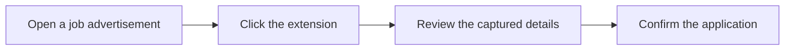

# Job Application Tracker extension

A Chrome and Edge extension for extracting job ads into tracker drafts and filling employer application forms.

It is designed to save repetitive copying while keeping the final decision with the user.

**[Install from the Chrome Web Store](https://chromewebstore.google.com/detail/ofeagkadonbdgjhdiobfdnmafhoknkig)** · **[Open Job Application Tracker](https://myjobtracker.com.au)**

Use the development package below to try the autofill build from this branch.

## How to use it

1. Sign in to [Job Application Tracker](https://myjobtracker.com.au/account/login).
2. Open a public job ad and choose **Extract** in the extension. Review the extracted details in the private draft before saving it.
3. Open **Extension → Autofill profile**. Enter your details or upload a text PDF or DOCX résumé up to 5 MB, then review the suggested contact details, work experience, education, certifications and links. Select **Save profile** to use those details in the extension. Use **Copy role** when a form needs manual entry.
4. Open an employer application and choose **Fill**. Fill connects to your saved profile automatically. If Chrome opens tracker sign-in, sign in, return to the employer form, and choose **Fill** again.
5. Review the completed fields, enter anything the form still needs, and submit from the employer's site.

Add country-specific work rights and sponsorship in **Screening questions**. Fill can answer clearly worded yes/no questions in standard dropdowns and radio groups. Use **Needs review** to check unmatched questions and approve saved written answers, salary, and workplace preferences. Choose a referee to copy their details one field at a time.

Open **Application documents** in the extension to choose a résumé, cover letter, or portfolio file. It keeps one PDF or DOCX up to 2 MB per document type in this browser. Select **Attach selected file** on the employer's application to attach it to an identified upload control. If the portal uses a custom uploader, attach the file on the form.

If the tracker asks you to sign in, return to the job advertisement after signing in and click the extension again.



## What it can capture

- Job title and company
- Location and workplace arrangement
- Employment type and advertised pay
- Job reference and closing date
- Readable job description
- The original job-page address

The job-ad reader supports structured `JobPosting` information and several named job-ad layouts. Fill separately uses standard form controls, accessible labels, autocomplete hints, and application section context. For repeated work experience, open the employer form's employment sections before filling. Custom pickers, inaccessible embedded sections, and employer-specific questions may need manual entry.

## Privacy in plain language

- The extension runs only after the user clicks it.
- It reads only the active tab at that moment.
- Extract sends the page address and visible job information to the tracker over HTTPS.
- It creates a temporary review draft rather than saving an application immediately.
- A pending handoff is encrypted, single-use, and expires after ten minutes.
- Fill reads your saved profile from the tracker using a revocable connection. The employer's website can read values filled into its form before you submit.
- Documents selected in the extension are stored in the browser. Remove a saved file from **Application documents**. The employer can receive the file as soon as you attach it.

Chrome lists these permissions:

| Permission | Why it is needed |
|---|---|
| `activeTab` | Temporarily read the page where the user clicked the extension |
| `scripting` | Run Extract or Fill after that click |
| `storage` | Hold the pending capture and profile connection in session memory and keep selected application documents in this browser |
| `identity` | Open tracker sign-in and return the connection to the extension |
| Tracker origin | Retrieve the connected profile from the tracker |

Read the public [extension privacy page](https://myjobtracker.com.au/extension/privacy) for the full explanation.

## Install it from this repository

This option is useful when reviewing or developing the project.

1. Apply the autofill migration to your **local development database**, then start Job Application Tracker and sign in.
2. Open `chrome://extensions` in Chrome or `edge://extensions` in Edge.
3. Turn on **Developer mode**.
4. Choose **Load unpacked**.
5. Generate and select a development package for your local tracker origin. With the default HTTP launch profile, run this from the repository root:

   ```powershell
   ./tools/New-BrowserExtensionPackage.ps1 -DevelopmentTrackerOrigin http://localhost:5261
   ```

6. Load the printed directory and pin **Job Application Tracker** to the toolbar.

After pulling an extension update, select **Reload** on the browser's extension page before testing an already-open job tab.

Run the package script without a development origin to create the production package. Its tracker destination is fixed to [myjobtracker.com.au](https://myjobtracker.com.au).

Return to the [main project README](../README.md) for the product overview, technology stack, and local application setup.
